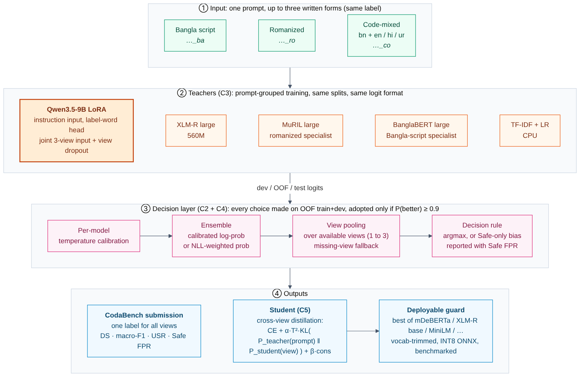

# TriGuard: Script-Invariant Safety Classification for Bangla

Working plan for **BanglaKnight, BLP-2027 Shared Task 1** (Adversarial Prompt Classification).
Goal: top of the test leaderboard, and a system paper strong enough for a best-paper award.

Author: Muhtasim Ibteda Shochcho | Version 2 | Last updated: 2026-11-01

Changes in version 2: Qwen3.5-9B LLM teacher (C3); decision layer redesigned as a measured comparison with calibration, weighted ensembling, missing-view fallback and a fixed reporting set (C2, C4); distillation redesigned with cross-view targets and a student benchmark (C5). Based on the E1/E2 results and an architecture review.

---

## 1. Task and metric

Each prompt is written in three forms (Bangla script, romanized, code-mixed). All three share one label:

| Label | Meaning |
|---|---|
| 0 Safe | neutral or harmless |
| 1 Offensive | insulting or discriminatory, no request for harmful help |
| 2 Harmful | asks for help with low or medium risk harm (misinformation, malicious requests) |
| 3 Severe | asks for help with high-risk harm (self-harm, jailbreaks, etc.) |

**Defense Score (DS) = mean(macro-F1 on bangla, romanized, codemixed) x (1 - USR)**
where USR (unsafe-as-safe rate) is the share of truly unsafe prompts (labels 1 to 3) predicted Safe. This definition is published on the leaderboard page; the organizers' starter notebook computes it.

Exactly what it rewards, and what it does not:
- **Missed unsafe prompts** (unsafe predicted Safe) are penalised twice: in macro-F1 (lower recall of the unsafe class, lower precision of Safe) and in the (1 - USR) multiplier.
- **False alarms** (Safe predicted unsafe, i.e. over-flagging) are penalised only once, through macro-F1 (lower Safe recall, lower precision of the unsafe class). They are *not* free: macro-F1 treats Safe as one of four equally weighted classes.
- **Confusions among unsafe classes** (Harmful vs Severe, the main error) cost macro-F1 only.
- Weak forms hurt directly, because F1 is averaged per form.

So any shift away from Safe trades Safe false positives for USR. Whether that trade pays off is an empirical question, measured per decision rule (section 4, C4). A higher DS bought with many more false alarms is not a better classifier, so **every result reports**: DS, macro-F1, USR, Safe false-positive rate (share of Safe prompts flagged unsafe), and per-class recall.

Key dates: test data Jan 8, 2027 | system deadline Jan 24 | results Feb 3 | paper Feb 15 (4 pages, ACL template, OpenReview).

---

## 2. What the data tells us

| Split | Prompts | Rows | Labels |
|---|---|---|---|
| train | 8,196 | 24,588 | Safe 34.1%, Offensive 15.3%, Harmful 26.3%, Severe 24.3% |
| dev | 2,049 | 6,147 | same distribution as train |
| devtest (blind) | 5,000 | 15,000 | unknown; estimated far fewer Safe, more Offensive |

- Every split has exactly 3 rows per prompt, linked by `prompt_id` (verified in devtest; the data page lists `prompt_id` for all files, including test).
- **Code-mixed is not only Bangla-English**: about 23% of code-mixed rows contain Devanagari (Hindi), about 15% Arabic script (Urdu).
- **Devtest is a different mix of sources** than dev: almost no native "bhai/bro" style prompts (0.2% vs 1.2%), much less English inside the Bangla form, shorter prompts, slightly further from train, lower model confidence. Models lose about 6.5 DS points from dev to devtest, and the loss is the same for TF-IDF and XLM-R, so dev still ranks models reliably.
- Dataset paper: BanglaShield (Kabir et al., 2026, arXiv 2610.24288). Cite it.

---

## 3. Evidence so far

| Model (dev, 3 views pooled) | DS | macro-F1 | USR | Safe FPR | Dev-test leaderboard |
|---|---|---|---|---|---|
| B0 TF-IDF + LR | 0.702 | 0.728 | 3.6% | 25.2% | 63.86 |
| E1 XLM-R large | 0.771 | 0.796 | 3.1% | 18.1% | 70.61 |
| E2 XLM-R large + consistency loss | 0.772 | 0.801 | 3.6% | 18.3% | |

Leaderboard on Nov 1: #1 84.48, #3 82.43, #10 73.50. **The gap to the top is about 14 points: model capability, not the decision layer, is the bottleneck.**

What we learned:
1. Pooling the three views at inference is worth +2 to +4 points over scoring rows separately, and guarantees consistent answers.
2. The consistency loss (C1) adds nothing once views are pooled at inference (E2 vs E1: +0.03 points, 95% CI -1.0 to +1.1).
3. Ensembling the same architecture twice helps little; adding a *different* model (TF-IDF) helps more.
4. **Harmful vs Severe** is the main error (165 of 2,049 dev prompts), then Safe false alarms.
5. On 2,049 dev prompts the DS standard deviation is about **1.0 point**. Differences below about 1 point cannot be resolved on dev alone (section 4, C4).

---

## 4. The approach

*Figure: TriGuard pipeline. Editable source: `docs/architecture.mmd`; vector version: `docs/architecture.svg`.*

### C1. Tri-view training
Each batch holds whole prompts (all three forms). `train_encoder.py` supports an optional consistency term
`L = CE + lambda * mean_v KL(p_v || p_mean)` (`--cons_w`). E2 showed no gain once views are pooled, so it is kept as a paper ablation, not as a core component. The tri-view idea moves into the LLM as **joint multi-view input with view dropout** (C3) and into distillation as **cross-view targets** (C5).

### C2. View pooling (prompt-level inference)
For prompt g with available views V_g:

    P_prompt(y) = sum_{v in V_g} alpha_v * P_v(y),   sum alpha_v = 1

Default: alpha_v = 1/|V_g| (plain mean of probabilities).

**Missing-view fallback** is built in: pooling runs over whatever rows share a `prompt_id` (3 views: pool all; 2 views: pool those two; 1 view: use it as is). If `prompt_id` were missing, the `_ba/_ro/_co` id suffix is used; if both are missing, predictions stay per row. Measured on dev (E1+E2+B0 ensemble):

| Available views | DS | macro-F1 | USR |
|---|---|---|---|
| bangla + romanized + code-mixed | 0.776 | 0.798 | 2.7% |
| bangla + code-mixed | 0.770 | 0.797 | 3.4% |
| bangla + romanized | 0.769 | 0.792 | 3.0% |
| romanized + code-mixed | 0.764 | 0.785 | 2.6% |
| bangla only | 0.777 | 0.806 | 3.6% |
| code-mixed only | 0.767 | 0.793 | 3.3% |
| romanized only | 0.726 | 0.753 | 3.6% |

Reading: the system degrades gracefully; romanized-only input is the weak case. Notably, Bangla-only ties 3-view pooling on DS (+0.16, CI -1.0 to +1.3): pooling buys lower USR, Bangla-only buys higher F1. Better romanized modelling (the LLM, or a romanized specialist) is what should make pooling clearly win.

Pooling variants tested (5 x 5-fold CV on dev, all weights fit on training folds only):

| Pooling | DS vs mean | Verdict |
|---|---|---|
| mean of probabilities | 0.00 | default |
| mean of log-probabilities | -0.10 | no gain |
| confidence-weighted (alpha by max prob) | +0.09 | within noise, keep as option |
| entropy-weighted | -0.06 | no gain |
| learned per-form weights | -0.71 | overfits |
| stacking meta-classifier (gating on all model x view outputs) | **-2.57** (CI -4.0 to -1.3) | clearly worse: USR doubles |

### C3. Teachers
Trained with the same splits and output format (`bk_common.write_logits`):
- `xlm-roberta-large` (560M): E1/E2, done.
- `google/muril-large-cased` (506M, trained on transliterated Indic text): romanized specialist candidate.
- `csebuetnlp/banglabert_large`: Bangla-script specialist (trained on Bangla rows only).
- **Qwen3.5-9B** (original release, local at `H:\Abliterate\Qwen3.5-9B`), LoRA classifier. Hybrid Gated DeltaNet + full attention, loaded text-only (about 8B, ~16 GB bf16), ~19 to 21 GB peak on the 4090, 4-bit fallback. Instruction-framed input, score head initialised from the label-word rows of `lm_head`, joint three-view input with view dropout, optional unsafe-mass penalty, layer-truncation ablation. Full design: `docs/LLM_DESIGN.md`. Expected to be the largest single gain.
- TF-IDF + LR: cheap, diverse ensemble member.

### C4. Decision layer: calibrate, ensemble, decide, measured not assumed
Three stages, each with candidates compared by `decision_lab.py` (repeated grouped CV; everything learned is fit on training folds only; paired bootstrap for significance).

**Stage 1, calibration.** Per-model temperature T_m fitted by NLL on training folds (E1 1.12, E2 1.01, TF-IDF 1.25 on full dev).

**Stage 2, ensemble.** Candidates:
- geometric (mean of log-probs, the original choice): sum_m log P_m / M, then renormalise
- arithmetic: P = (1/M) sum_m P_m
- weighted arithmetic: P = sum_m w_m P_m, sum w_m = 1, weights fit on training folds by NLL (more stable than fitting by DS)
- calibrated geometric / calibrated arithmetic: same after temperature scaling

**Stage 3, decision rule.** Candidates: argmax (no bias); Safe-only bias (one parameter, subtracted from the Safe log-prob, fit on training folds); 4-class bias; Safe threshold (predict Safe only if P(Safe) >= tau). Class-weighted training is the training-time counterpart and is tested as a separate run (E6).

Results on dev (E1 + E2 + B0, 5 x 5-fold CV), relative to the original pipeline:

| Change | DS diff (points) | 95% CI | P(better) | Safe FPR | Verdict |
|---|---|---|---|---|---|
| arithmetic instead of geometric | +0.03 | -0.5 to +0.6 | 0.53 | 19.9% | equivalent |
| NLL-weighted arithmetic (w = 0.3/0.5/0.2) | +0.36 | -0.5 to +1.3 | 0.78 | 18.5% | promising, unresolved |
| calibrated geometric | +0.30 | -0.1 to +0.7 | **0.92** | 19.5% | most consistent small gain |
| Safe-only bias | +0.44 | -0.3 to +1.2 | 0.86 | 21.5% | gains via USR (2.7% to 2.0%), costs 1.6 pts Safe FPR |
| 4-class bias | +0.05 | | | 20.9% | overfits |
| Safe threshold | -0.51 | | | 22.0% | worse |
| stacking | -2.60 | -4.0 to -1.3 | 0.00 | 13.9% | reject |

Conclusions:
1. The original pipeline was not wrong, but **calibrated log-prob pooling** is the most reliable small improvement, and **NLL-weighted probability averaging** is the interpretable alternative to keep testing, as the review suggested.
2. Gains from the decision layer are about 0.3 to 0.5 points, below the 1-point noise of dev. **Final choices are made on out-of-fold logits over train+dev** (about 10,000 prompts, noise about 0.5 points): adopt a change only if P(better) >= 0.9.
3. The Safe bias is a deliberate trade: report USR and Safe FPR side by side; adopt it only if the OOF gain holds.
4. Until the OOF decision: calibrated geometric ensemble, mean view pooling, argmax.

### C5. Lightweight student with cross-view distillation
Loss for a student that sees **one view per row**:

    L_student = CE(y, P_s(x_v)) + alpha * T^2 * KL( P_t^T(prompt) || P_s^T(x_v) ) + beta * L_consistency

- **Cross-view teacher targets** (the key change): the teacher target for every single-view row x_v is the teacher's *pooled three-view* distribution P_t(prompt), not the teacher's output on that same row. A student that only ever sees one form at deployment (the realistic case: a user writes in one script) learns to reproduce the three-view decision. This directly targets the weak romanized case in the table above.
- L_consistency: KL between the student's own views of a prompt (as in C1). Because all views share one target, it is expected to be largely redundant; kept as an ablation (beta = 0 vs 0.5).
- T in {1, 2, 4}, alpha in {0.5, 1}. Teacher = the final calibrated ensemble (incl. Qwen3.5-9B).
- Distilling on unlabelled devtest/test text (teacher outputs as targets) would help with the source shift, but counts as transductive use of blind data: **only if the organizers confirm it is allowed.**

**Student candidates.** Most parameters of multilingual encoders sit in the vocabulary embedding, a lookup table that costs memory but almost no compute:

| Student | Params | Embedding | Transformer | Notes |
|---|---|---|---|---|
| mDeBERTa-v3-base | 279M | 193M | 86M | strongest base-size candidate |
| XLM-R base | 278M | 192M | 86M | multilingual comparison |
| distilbert-base-multilingual-cased | 135M | 92M | 43M | 6 layers, fast |
| Multilingual-MiniLM-L12-H384 | 118M | 96M | 21M | smallest compute |
| BanglaBERT base | 110M | 25M | 86M | Bangla-script vocab; check romanized/Hindi/Urdu coverage |

**Vocabulary trimming**: keep only the token ids that occur in train/dev/devtest/test text (plus specials). This typically removes 80 to 90% of a 250k-token embedding with identical outputs on that text, e.g. mDeBERTa-v3-base to roughly 100M and MiniLM to roughly 30M. To be measured, not assumed.

**Benchmark the real artifact** (ONNX Runtime, dynamic INT8), not parameter counts: DS and macro-F1 (FP32 and INT8, i.e. quantisation drop), file size, peak RAM, CPU latency p50/p95 at batch 1, throughput at batch 32, all at max length 256 on a stated CPU.

### C6. Ideas to test, keep only if they help
- Class-weighted training (E6) vs post-hoc Safe bias
- Hierarchical head: Safe vs unsafe gate, then severity
- Label-noise check (confident learning) on Harmful vs Severe
- Domain adaptation to devtest/test text (continued pretraining) and pseudo-labelling: only if the rules allow
- External Bangla safety data: only if the rules allow

---

## 5. Experiment plan (fill in as results come)

Report for every row: DS, macro-F1, USR, Safe FPR, per-class recall, per-form F1 (row level), minutes, VRAM.

| ID | Model / change | Status | Dev DS |
|---|---|---|---|
| B0 | TF-IDF LR | done | 0.702 |
| B1 | BanglaBERT (starter notebook) | todo | |
| E1 | XLM-R large | done | 0.771 |
| E2 | XLM-R large + consistency | done | 0.772 |
| E3 | XLM-R large joint input | todo | |
| E4 | MuRIL large | todo | |
| E5 | BanglaBERT large, Bangla rows only | todo | |
| E6 | XLM-R large, class-weighted CE | todo | |
| L0 | Qwen3.5-9B smoke test (VRAM, speed) | todo | |
| L1 | Qwen3.5-9B rows mode | todo | |
| L2 | Qwen3.5-9B joint + view dropout | todo | |
| L3 | best L + unsafe-mass penalty | todo | |
| L4 | best L, first 24 layers only | todo | |
| D1 | decision layer comparison on OOF train+dev | todo | |
| S1 to S5 | students (table in C5), cross-view KD | todo | |
| S6 | best student, vocab-trimmed, INT8 ONNX benchmark | todo | |

---

## 6. Timeline

| When | What |
|---|---|
| Nov 1 to 3 | Done: setup, B0, E1, E2, first submissions, decision-layer study. |
| Nov 3 to 15 | Qwen3.5-9B: environment, L0 to L2. MuRIL / BanglaBERT specialists in parallel slots. |
| Nov 15 to 30 | L3, L4, E6. Pick the teacher set. |
| Dec 1 to 20 | 5-fold CV over train+dev for the teacher set, OOF logits, decision layer D1 (decide with P >= 0.9). |
| Dec 20 to Jan 5 | Students S1 to S6, vocab trimming, ONNX benchmark. |
| Jan 1 to 7 | Freeze; one-command `final.ps1`; dry run on devtest. |
| Jan 8 to 24 | Test phase (3 submissions/day, 10 total): retrain on train+dev, predict test, submit early, final at least 48 h before the deadline. |
| Jan 25 to Feb 15 | Paper. |

---

## 7. Paper plan (4 pages)

Working title: *TriGuard: Multi-View Pooling, Calibrated Ensembling and Cross-View Distillation for Script-Robust Bangla Safety Classification*

1. Introduction: unsafe prompts slip through under romanization and code-mixing (BanglaShield, BanglaVeilGuard)
2. Data: script mix, dev vs devtest source shift
3. Method: view pooling with missing-view fallback, LLM teacher with joint multi-view input, calibrated decision layer, cross-view distillation
4. Results: leaderboard, main table, ablations with confidence intervals
5. Analysis (what makes it award-worthy):
   - when does pooling beat the best single view, and why romanized is the weak witness
   - honest negatives: consistency loss redundant under pooling; stacking/gating overfits and doubles USR
   - the DS trade-off made explicit: USR vs Safe false-positive rate for each decision rule
   - layer-wise similarity of the three views inside the LLM (and the 24-layer truncation result)
   - student cost: size, RAM, latency, INT8 drop, vocab trimming
6. Limitations and ethics (over-flagging cost, no harmful content reproduced)

---

## 8. Risks and open questions

- Rules still unknown: external data, LLM use, transductive use of blind text. **Ask on the CodaBench forum.** Submission limits: dev 10/day, test 3/day and 10 total.
- `prompt_id` is documented for test and verified in devtest; fallback chain in C2 covers the rest.
- Small dev set (DS noise about 1 point): decisions on OOF train+dev.
- Source shift dev to devtest (and likely test): favour diverse teachers and the LLM.
- Qwen3.5 needs transformers 5.x: separate `.venv-llm`, so the encoder pipeline stays stable.

---

## 9. Repo map

| File | Purpose |
|---|---|
| `bk_common.py` | loading, Defense Score, logit files |
| `tfidf_baseline.py` | CPU baseline and ensemble member |
| `train_encoder.py` | encoder fine-tuning (optional consistency loss) |
| `decide.py` | ensemble, view pooling, bias, CodaBench zip |
| `decision_lab.py` | compares ensemble / pooling / decision strategies with CV + paired bootstrap |
| `docs/LLM_DESIGN.md` | Qwen3.5-9B classifier design |
| `setup.ps1` / `smoke_test.ps1` | Windows setup and feasibility test |
| `docs/architecture.*` | architecture diagram (PNG, SVG, Mermaid source) |
| `requirements.txt` / `requirements.lock.txt` | pinned deps / exact frozen environment |
